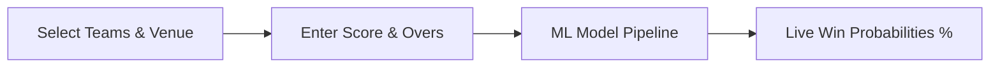

<div align="center">

# 🏏 IPL Win Probability Predictor

**A real-time Machine Learning web app to predict winning probabilities for IPL matches.**

[](https://ipl-win-probability-predictor-garima.streamlit.app/)

<br>

[](https://ipl-win-probability-predictor-garima.streamlit.app/)
[](https://www.python.org/)
[](https://scikit-learn.org/)
[](https://pandas.pydata.org/)
[](https://opensource.org/licenses/MIT)

<p align="center">
  <a href="#-features">Features</a> •
  <a href="#-supported-teams">Teams</a> •
  <a href="#-how-it-works">How It Works</a> •
  <a href="#-quick-start">Quick Start</a> •
  <a href="#-project-structure">Structure</a>
</p>

---

</div>

## 📌 Overview

The **IPL Win Probability Predictor** estimates the live win probability of both the batting (chasing) and bowling (defending) teams during the second innings of an Indian Premier League match. 

It uses a calibrated **Machine Learning model** trained on historical IPL match data to evaluate live factors like runs needed, balls left, wickets in hand, and venue conditions.

> 🔗 **Try the live web app:** **[https://ipl-win-probability-predictor-garima.streamlit.app/](https://ipl-win-probability-predictor-garima.streamlit.app/)**

---

## ✨ Features

- ⚡ **Instant Predictions:** Live win percentage calculation for both teams.
- 🏏 **Official Team Logos & Flags:** Interactive badges for all 10 active IPL franchises.
- 📊 **Match Dynamics:** Real-time calculation of:
  - 🎯 Target Score
  - ⚡ Runs Needed & Balls Left
  - 🏏 Wickets in Hand
  - 📈 Current Run Rate (CRR)
  - 🔥 Required Run Rate (RRR)
- 📱 **Responsive UI:** Clean, modern, and mobile-friendly interface built with Streamlit.

---

## 🏟️ Supported Teams

<table>
  <tr>
    <td align="center">🟡 <b>Chennai Super Kings</b> (CSK)</td>
    <td align="center">🔵 <b>Mumbai Indians</b> (MI)</td>
  </tr>
  <tr>
    <td align="center">🔴 <b>Royal Challengers Bengaluru</b> (RCB)</td>
    <td align="center">🟣 <b>Kolkata Knight Riders</b> (KKR)</td>
  </tr>
  <tr>
    <td align="center">🔵 <b>Delhi Capitals</b> (DC)</td>
    <td align="center">🟠 <b>Sunrisers Hyderabad</b> (SRH)</td>
  </tr>
  <tr>
    <td align="center">🔴 <b>Punjab Kings</b> (PBKS)</td>
    <td align="center">🌸 <b>Rajasthan Royals</b> (RR)</td>
  </tr>
  <tr>
    <td align="center">🔷 <b>Gujarat Titans</b> (GT)</td>
    <td align="center">🔹 <b>Lucknow Super Giants</b> (LSG)</td>
  </tr>
</table>

---

## ⚡ How It Works



1. **Select Match Teams:** Choose the batting and bowling teams (official flags load automatically).
2. **Enter Match State:** Input current score, overs completed, target, and wickets out.
3. **Get Results:** Click **"Find Win Probability"** to view real-time winning odds and match metrics.

---

## 🛠️ Tech Stack

| Technology | Purpose |
| :--- | :--- |
| **Python** | Core programming language |
| **Streamlit** | Interactive web dashboard |
| **Scikit-Learn** | Predictive machine learning model |
| **Pandas & NumPy** | Data processing & feature calculations |

---

## 🚀 Quick Start (Run Locally)

### 1. Clone the repository
```bash
git clone https://github.com/GarimaVerma45/IPL-Win-Probability-Predictor.git
cd IPL-Win-Probability-Predictor
```

### 2. Install requirements
```bash
pip install -r requirements.txt
```

### 3. Launch the app
```bash
streamlit run app.py
```

Your app will open in the browser at `http://localhost:8501`.

---

## 📂 Project Structure

```text
├── assets/
│   └── logos/         # High-resolution team flags (.png)
├── app.py             # Streamlit web application
├── matches.csv        # IPL match dataset
├── pipe.pkl           # Pre-trained ML pipeline
├── metadata.json      # Teams, venues & color codes
├── requirements.txt   # Dependencies
└── README.md          # Project documentation
```

---

## 👤 Author

**Garima Verma**
- GitHub: [@GarimaVerma45](https://github.com/GarimaVerma45)
- Live App: [ipl-win-probability-predictor-garima.streamlit.app](https://ipl-win-probability-predictor-garima.streamlit.app/)

---

<div align="center">
  <sub>Built with ❤️ using Python & Streamlit</sub>
</div>
